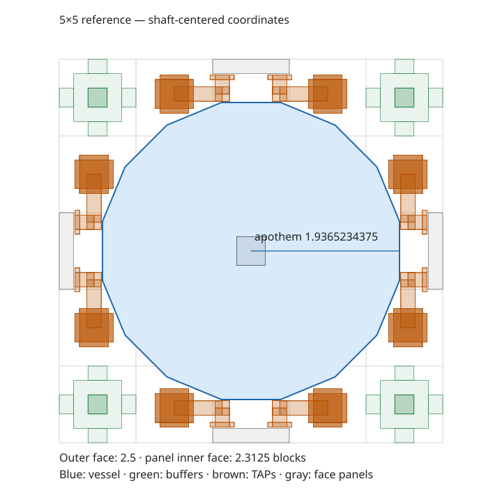

# 02 — Multiblocks

## 2.1 Vat structure and specimens

Vat exterior maxima (X/Y/Z) are Copper T1 9 × 7 × 9, Iron T2 9 × 9 × 9 and Blood Iron T3 12 × 12 × 12. Rectangular footprints are supported. The structural floor is 3 × 3 × 3; actual specimen and service geometry governs the minimum (one-cell chicken 3 × 3 × 3; normal two-cell cow 3 × 4 × 3). Exactly one Controller and at least one encoded Head are required. The entire machine validates together: incomplete or ambiguous specimens reject formation rather than being skipped.

The tier-specific Controller is authoritative. Every tier-bearing shell cell, including glass and installed machinery/conduit/buffer cladding, must match it. Mixed shells report the offending position and expected material. Internal service placement does not select tier. Universal functional machinery keeps its existing item and entity behavior. T2+ permits complete hostile specimens to form while dormant. Each encoded hostile Head requires a one-time strike on an upright vanilla rod directly on its owned roof Harness; passive specimens remain independent. See [hostile activation](HOSTILE_SPECIMENS.md). See [tier construction](design/VAT_TIERS_AND_CONSTRUCTION.md).

Each Head supplies persisted `SimulacrumGeometry`. The ownership map validates every Head/Flesh occupied cell; extra unowned Flesh and overlapping bodies are invalid. Multiple independent specimens are implemented. Touching, one-gap and wider layouts may form if substrate and service requirements are satisfied. Space affects productivity through comfort; it is not an automatic packing system.

Frame, face and interior legality are delegated to physical part rules and the installed material's shell rules. Corners and horizontal frame edges require suitable casing treatment; vertical edge glass is supported. Interior service space accepts permitted medium, specimen parts and legal conduits/mechanisms; arbitrary occupied cells are rejected. Use sneak/right-click validation to obtain the current error and coordinates.

Each specimen resolves its own complete footprint-corner Harness plane. Harnesses cannot be shared. The Harness plane and Sump may each have 0..4 vertical spacer blocks; Sump horizontal offset is at most 2 blocks from the occupied footprint. A Sump is selected below each body using eligible horizontal/vertical ranges; nearest horizontal Manhattan distance then vertical distance resolves assignment, with ties rejected. Exactly one Sump per specimen and no unassociated extra services are allowed. Sump retains the compatibility ID `mobvats:vat_drain`; it is distinct from the environment Drain Valve.

## 2.2 Mixer structure and drive placement

Mixer exterior dimensions are 3 through 9 on each axis. One top-centered Impeller requires odd horizontal dimensions; rectangular odd footprints are supported, with nominal vessel diameter equal to the smaller horizontal dimension. Exactly one Controller and a contiguous vertical Shaft chain below the Impeller are required. Shaft depth is 1 through 8; disconnected/off-axis Shaft blocks fail validation.

Zero or one Drive may be present structurally. A Drive couples at the same Y as the Impeller, exactly one cardinal block away. Creative, combustion and FE drives are implemented. Productive operation requires a drive supplying full power. Startup lasts `slots × 200` ticks. Losing drive or disabling the Mixer stops it; saved resources persist. FE storage accepts energy through the native NeoForge capability on all sides into a receive-only 1,000,000 FE buffer; no energy conduit network is implemented. The default cost is 2,500 FE per 200 powered ticks, including startup and idle running, independent of slot count. Fractional prepaid credit and stored energy persist. Combustion acquires native furnace fuel through ordered item demand and retains fuel/container remainders on the motor; its routed fuel Store is separate from recipe inputs. Creative Drive provides full drive without resource consumption.

## 2.3 Canonical vessel and capacity

The following geometry contract is consolidated from the current geometry reference and verified against `MixerVesselGeometry`, `MixerSweep` and `MixerAssembly`. Generated charts remain separate and must be regenerated from their Java producer rather than edited manually.


`MixerVesselGeometry` is the immutable physical contract used by formation,
`MixerSweep`, `MixerAssembly`, rendering descriptors and generated placement charts.
Geometry is compiled on assembly and relevant changes, not on every frame or idle
tick. Buffer identity transitions enqueue a geometry recheck without rebuilding
fluid routing.

### 2.3.1 Polygon and reference radius

For horizontal width D, N = 4(D - 1). Face normals point along the cardinal
directions; vertices are rotated by half a segment. Radius means apothem, and
vertex radius is apothem / cos(pi/N). Collision uses the convex polygon's face
planes, including its vertices, rather than an approximate circle.

The 5×5 reference reserves four corner buffers and eight edge fluid conduit
positions, each one cell sideways from a cardinal midpoint. Both casing and
glass cladding, vertical TRUNK collars, and TAP branches toward the adjoining
cardinal-face endpoint are included. Every occupied AABB is inflated horizontally
by 1/64 block. Its maximum admissible apothem is obtained by a separating-axis
test against the polygon face normals. The smallest bound across all reserved
devices and shell panels defines the reference radius.

The resulting reference apothem is **1.9365234375 blocks**. TAP elbow boxes are
the limiting volumes: their inner radial plane is 1.9521484375 blocks from the
shaft; subtracting the explicit safety clearance gives the reference apothem.
Without endpoint fittings, riser collars alone would permit 1.9506112774516602.
The production calculation derives the radius from actual `ConduitGeometry`
volumes; those numbers are explanatory results, not a substitute formula.

Other sizes use r(D) = r(5) × (D - 1) / 4. No per-size optimization occurs.
Physical boundaries are not rounded to pixels.

### 2.3.2 Cardinal-face connections



Coordinates are measured from the shaft center. The enclosure outer face is
2.5 blocks away; its 3/16-deep panel ends at 2.3125. Pipe centers on that face
are 2.046875 blocks away. The generated top view projects the actual occupied
buffer and TAP volumes used in the radius calculation, including the branches
to midpoint devices.

The generated 5×5 grid is:

```text
B C X C B
C X X X C
X X S X X
C X X X C
B C X C B
```

The C cells are offset sideways from the cardinal midpoint. At a sideways offset
of one block the polygon boundary lies approximately 1.682 blocks from the shaft,
so a cladded riser can fit even though the cardinal apothem is approximately 1.937.
Shell location positions the pipe near the panel. Bare and clad pipes use
identical positions and occupied volumes; only structural legality differs.
TAP branches connect from the C cells to devices
at the cardinal face midpoint. A runtime GameTest installs and checks fittings
on all four cardinal faces using the actual compiled geometry.

A pipe installed directly at the cardinal midpoint occupies X space and requires
a radius reduction. An endpoint panel there can be served from the adjacent C
cell. Additional horizontal pipe runs, bridges, and endpoint arrangements are
checked against their actual snapshot; C is not permission for arbitrary geometry.

The 3×3 grid remains CXC/XSX/CXC for cladded vertical TRUNK risers. Its corner TAP
branches toward adjacent cardinal endpoints do not clear the canonical envelope.
The detailed tables explicitly report this difference. The 5×5 edge C cells clear
both reference TRUNK and TAP configurations.

### 2.3.3 Device envelopes

`FluidBufferGeometry.BODY` is 10×10×13 pixels: local X/Z 3/16 through 13/16,
Y 2/16 through 15/16. A supported body has a centered 4×4-pixel foot down to Y=0.
Short casing mounts use a centered 4×4-pixel cross-section extending from the
body to the neighboring block boundary. Compatible neighbors reserve half-bridges
with the body's full cross-section; both halves form the continuous connection.

Bridge membership comes from `PhysicalFluidStorage` clustering. Filter equality
alone does not join incompatible stored fluid/component identities or allow an
empty intermediary to bridge two incompatible clusters. Storage capacities,
filters and routing rules are unchanged.

Conduits reuse `ConduitGeometry`: actual body segments, collars, bends and
endpoint fittings. Bare, casing-clad and glass-clad cells and TRUNK/TAP modes
are evaluated separately. Structural placement permission still comes from
`MixerPlacement`; physical clearance does not override it.

### 2.3.4 Uniform structural reduction

If any occupied device intersects the canonical envelope or its safety margin,
formation tries r - 1, r - 2, and so on, keeping one uniform polygon along the
entire reached shaft depth. Every selected envelope clears every device. There
are **no local capacity deductions or gaps around obstructions**. If no radius
with shaft and rotor clearance remains, formation fails with an offending-device
diagnostic. Actual device envelopes and the canonical polygon remain authoritative
for formation, obstruction clearance and rendering boundaries.

### 2.3.5 Approximate processing capacity

There is one authoritative calculation, in `MixerAssembly.slotCount()`:

`slots = floor((effectiveDiameter - 1)^2 * shaftLength / 8)`

`effectiveDiameter = nominalDiameter - 2 * radiusReduction`. Each radius step
removes one block from both sides. Existing geometry validation permits effective
diameters of at least 3. Shaft length counts actual contiguous installed mixing
blocks, from 1 through 8. Full-depth installation has shaftLength = H - 1; shorter
Shafts receive capacity only for installed depth. Integer arithmetic yields 64
slots naturally at 9×9×9, with no separate clamp.

| Footprint | Height 3 | Height 5 | Height 7 | Height 9 |
|---|---:|---:|---:|---:|
| 3×3 | 1 | 2 | 3 | 4 |
| 5×5 | 4 | 8 | 12 | 16 |
| 7×7 | 9 | 18 | 27 | 36 |
| 9×9 | 16 | 32 | 48 | 64 |

At depth 8, nominal diameter 9 reduced by 0, 1, 2 or 3 radius steps has
effective diameter 9, 7, 5 or 3 and 64, 36, 16 or 4 slots. At diameter 5,
depth 3 gives 6 slots; one reduction gives 1 slot. A one-block Shaft at diameter
3 yields zero slots; the minimum full-depth 3×3×3 Mixer has one slot.

Capacity approximates vessel footprint and mixing depth. Shaft thickness, rotor
artwork, individual pixels and floor-shell inset do not deduct slots. The
3-pixel bottom shell inset still constrains physical clearance and rendering.
Machinery outside installed depth cannot shrink the vessel.

The centered square Shaft is exactly 6×6 pixels (0.375 blocks), local X/Z
5..11 pixels. Physical shape, construction/inventory models, formed rendering,
central liquid exclusion and the generated reference diagram use that dimension.
Mixer Shafts are vertical; the square is invariant under cardinal rotations and
mirrors. The formed Shaft ends at the inner vessel floor. Crossing paddles still
attach through its center at the first usable level, within the canonical vessel.

Pixel columns remain for liquid presentation and explicitly geometric
`geometricSweptVoxels()` / `geometricSweptVolume()` diagnostics. They do not feed
slots. The old pixel-capacity denominator and division have been removed.

Drive/process relationships are unchanged: startup takes slots × 200 ticks;
FE startup costs slots × configured FE per cycle; running FE costs one cycle
per 200 ticks. The executor retains one active recipe, existing batch cadence
and atomic transactions. Slots do not introduce additional recipe concurrency.
At 64 slots startup is 12,800 ticks, safely within integer arithmetic.

Save version 3 stores diameter, radius-reduction steps, shaft depth and floor inset;
geometric volume and slots are derived. Version-3 assemblies recompute slots from
dimensions on load. Legacy obstruction masks are rejected and rebuilt through
the normal structure lifecycle.

### 2.3.6 Charts, fixtures and presentation

[Generated clearance tables](generated/MIXER_CLEARANCE_GENERATED.md) contain grids for all
four widths and per-cell structural legality, canonical fit, actual intersection,
and required whole-vessel reduction for each device variant. Regenerate them with
`MixerVesselGeometryGameTests.generatedClearanceReport`; the GameTest run writes
`.cache/gametest/mixer-clearance.md`. Copy that output to the tracked document.

The historical dense storage fixture remains available unchanged and fails the
physical clearance check. Runtime operating regressions use peripheral buffers
and safe conduit paths; they retain storage/filter counts and test behavior.
The generated acceptance world has not been redesigned. Acceptance tests check
zero intersections and produce `mixer-acceptance-clearance.txt` and
`mixer-annex-clearance.txt` with actual reductions and canonical conflicts.

The unchanged full-height acceptance enclosure selects the canonical radius,
shaft depth 3 and 6 slots. The culture annex adds a midpoint
conduit at enclosure-relative (0,2,2); its body, collars and connecting run from
(0,2,1) intersect the canonical envelope. It selects one radius step, apothem
0.9365234375 and 1 slot. Both selected vessels have zero physical
intersections. These results are measured by the acceptance GameTests.

`MixerRenderDescriptor` consumes the selected polygon's exact vertices. Each
edge has one exterior wall and an inset interior wall, extending through the
reached shaft depth. A continuous inset rim leaves the vessel open; the bottom
uses center fans with one triangle per edge on each visible side. The inner wall
and bottom are separated from the exterior by 1/32 block. Paddle reach includes
this presentation thickness without changing the physical clearance contract.
The client bakes these meshes only when the assembled descriptor changes.

The working-liquid fan uses the same polygon with a small additional inset.
One bucket per block of geometric swept volume sets its height, quantized
to pixel layers and clamped 1/8 block below the rim. Fluid identity and tint are
independent of the verdigris material. Presentation selects the active or next
executable recipe and its executable strategy, excluding unrelated outputs and
additives. Ambiguous fluid identities remain empty. The current executor commits
consumption and production together at batch completion; inputs remain physical
storage during processing, so no consumed-batch snapshot or extra fluid tank is
needed. Network updates send the selected FluidStack and its components.
Connected-buffer rendering and rotor animation are implemented through their existing render owners; historical validation outcomes remain in the geometry archive.

## 2.4 Universal mechanical parts and installed materials

Mechanical inventory items represent functions. Casing and glass are materials installed on placed machinery, not mechanical item variants.

### 2.4.1 Registered functions

There are two resource-specific conduit blocks, one buffer, and one block/item for each of `item_port`, `fluid_port`, `tool_port`, `feed_port`, `blender`, `pull_pump`, `push_pump`, `fill_valve`, `drain_valve`, `item_void` and `fluid_void`. Item/Fluid Conduit TRUNK and TAP items remain temporarily, with one shared block per resource. Mode remains the `mode` blockstate property. Mixer input/output direction-only registrations were removed; port direction remains functional endpoint configuration.

Vat/Mixer controller, casing, glass, rotor, drives, specimen substrate and other genuinely distinct structural functions retain their existing registrations. Existing family-specific functional Block Entity types remain ZeroCore adapters; they are not compatibility block/item entries.

### 2.4.2 Installed material and interactions

The single `cladding_material` enum property supports `none`, Vat casing/glass for each of `t1`, `t2`, `t3`, and `mixer_t1_casing` / `mixer_t1_glass`. It determines the exact material item, shell family and glass/casing treatment. No additional entity exists solely to store cladding, and no NBT field duplicates installed material. Harness and Sump retain `vat_harness` / `vat_drain` and use this same mechanism: shell mounts require matching cladding, while bare interior supports retain their geometry and association rules.

Place the bare function item, then shift-right-click it with an actual casing/glass item. The casing/glass item's `useOn` handles Minecraft's sneaking placement bypass and invokes the same shared policy as the block interaction. Survival installation consumes one item. Creative installation consumes none. Identical material does nothing. Replacement returns the old material to inventory, dropping it if insertion fails. Unsupported materials are rejected. Vat-only service functions reject Mixer material; the five shared port/pump/void functions support both families.

Only the targeted block changes. Connectivity, neighbors, controllers and assembly never select or propagate material. TRUNK/TAP mode is preserved. There is no removal tool in this slice; replace material or break the block.

### 2.4.3 Resource preservation and drops

Installed materials are recovered exclusively through block loot tables, using material-state conditions and normal explosion survival rules. No removal callback also emits cladding. Bare machinery drops its universal function item; clad machinery additionally drops its exact material item. Silk Touch uses the same path. Normal creative destruction suppresses both drops. Pick Block returns the universal function item (including the selected conduit mode), with the existing portable functional state where applicable.

Buffers retain the same entity, tank, fluid components and filter through every material replacement. Same-family fixture changes retain their entity. Explicit cross-family changes select the existing Vat or Mixer ZeroCore adapter and transfer whitelisted functional data through ZeroCore's public sync contract. Ownership and assembly snapshots are excluded. Resources belonging to the inactive adapter, such as a Vat staging slot versus a Mixer fuel store, remain retained and restore if the family is changed back. Portable machinery drops preserve this data. Port staging and specimen tool resources are retained in the machinery item rather than emitted a second time by a removal callback.

### 2.4.4 Structural and physical behavior

Conduit and buffer structural permission, continuation, bounds and passive part counts read installed material instead of constructor fields. Vat and Mixer envelopes stay separate. Casing/glass position permissions remain family-specific. Bare passive machinery retains its interior permissions. Mechanical entities must satisfy both their existing functional placement rule and the installed material's shell rule; existing interior service permissions remain available.

Only passive conduits and buffers contribute to passive bridge counts. Functional entities remain ordinary ZeroCore parts and are counted once. Cladding changes enqueue structural revalidation, topology invalidation and buffer presentation refresh. Controller ownership continues to use ZeroCore. No framework modifications were made.

Bare conduit collision is empty; clad conduit collision is full-block. Existing routing, TAP clearance, occupied geometry, buffer displacement and compatible-buffer joining remain unchanged. Mechanical shells use non-occluding models to support glass and open construction presentation. No new waterlogging capability was added.

Copper T1 and Iron T2 structural materials are Survival-craftable. Blood Iron T3 materials are registered in Creative with no Survival recipes. All tiers enforce matching shell/cladding materials and have headless formation/mismatch coverage. Functional machinery remains universal; crafting conventions use Copper for fluids, Iron for items/motion, Iron plus Leather for Harnesses, and a Diamond for Blenders. See the [recipe audit](SURVIVAL_RECIPES.md). Hostile activation and Blood Iron manufacturing remain future work. Future materials extend the installed-material enum, actual structural items/policies and procedural palettes; they do not add mechanical block/item registrations or tiers to mechanical functions.

### 2.4.5 Rendering

Material blockstates select generated procedural construction models. Universal inventories use bare machinery. Clad, unformed models add the existing family construction frame; formed chunk models select the material shell and remove that frame. Stationary fixture rendering retains mechanisms, pump orientation/sleeves, void treatments and service fixture mounting. Installed shells replace the old exterior service backing plate to avoid coincident geometry. Glass shells retain their translucent layer. Conduit formed meshes and buffer reservoirs keep their existing render owners and joining geometry. No runtime textures are generated. Art-only T2/T3 palette previews remain available.

### 2.4.6 Direct consolidation and disposable fixtures

No legacy world migration, aliases, data fixers or compatibility blocks/items were added or retained. Old material-specific conduit/buffer blocks and items, duplicate Mixer mechanical blocks/items, direction-only Mixer ports, their item models, blockstates, recipes and stale model aliases were removed. Material appearance models remain because they render installed states.

Disposable worlds must be regenerated. Every fixture builder uses explicit final unified material states, including standard acceptance, creative production, four-cow production, operator Vats, Mixer fixtures and minimum-XP P-06. World generation never simulates player cladding. Historical placement GameTests that exercise gameplay place bare conduits and then use the material interaction.

`tools/verify_unified_world.py` reads Anvil block palettes and item inventories, rejects obsolete IDs, and checks material/mode properties. It deliberately permits the existing functional Block Entity IDs.
